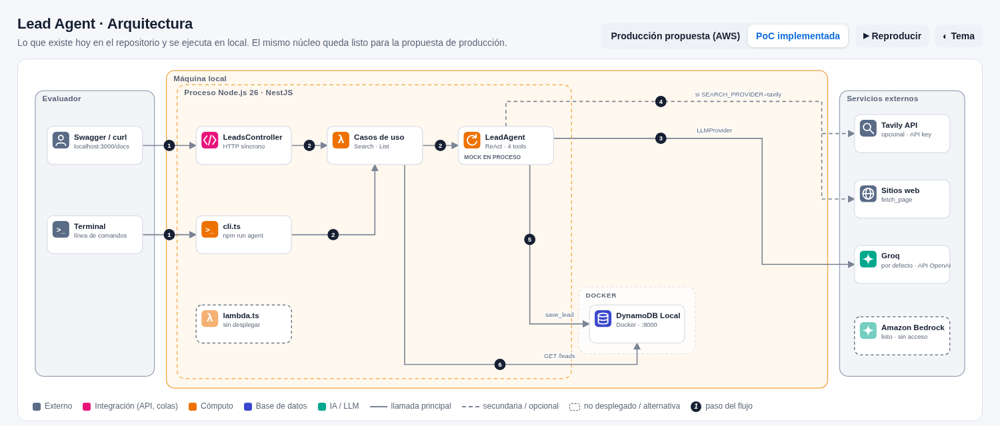

# Lead Agent — Agente IA para Extracción y Cualificación de Leads

Prueba de concepto (PoC) de un agente IA que, a partir de un **sector empresarial** y una **ubicación**, busca empresas en fuentes públicas de internet, extrae y estructura sus datos con un LLM, los cualifica y los guarda en una base de datos para el equipo comercial.

---

## 1. Finalidad funcional

Hoy la prospección es manual: un vendedor busca "clínicas dentales en Lima", entra a cada web, copia nombre, actividad y contacto a un Excel. Este agente automatiza ese flujo:

1. Recibe `sector` + `ubicación` (CLI o endpoint HTTP).
2. El LLM decide qué buscar y ejecuta búsquedas web (tool calling).
3. Analiza los resultados y descarta lo que no es una empresa real del sector, registrando el motivo.
4. **Extrae** datos estructurados (JSON validado).
5. **Cualifica** cada lead: estima qué tan útil es para el equipo comercial, para priorizar el contacto.
6. Decide guardar cada lead válido en la base de datos (deduplicado por dominio).

---

## 2. Decisiones de alcance (ambigüedades del enunciado resueltas)

| Ambigüedad | Decisión |
|---|---|
| "Guardar automáticamente" vs. "el LLM decide cuándo guardar" | Guardar es un **tool** (`save_lead`) que el LLM invoca; el código valida con Zod antes de persistir. Si la validación falla, el error vuelve al LLM para que se autocorrija. |
| "Cualificación" no está definida | Se cualifica con señales observables en fuentes públicas: encaje con sector y ubicación, legitimidad (empresa real vs. directorio/anuncio), contactabilidad y señales de tamaño/madurez. Resultado: `qualificationScore` (0–100), `qualificationReason`, `confidence`. |
| "Sector" es input y output | En la salida se guarda `subSector` detectado (ej. "Ortodoncia" dentro de "Clínicas dentales"), además del sector solicitado. |
| "Posibles datos de contacto" invita a alucinar | Solo se guardan contactos que aparezcan **literalmente** en la fuente; si no, `null`. `sourceUrl` es obligatorio. |
| B2C implica datos personales | Foco en **B2B**. Tratamiento de datos personales (Ley 29733, Perú) queda documentado en limitaciones. |
| Lead sin sitio web | Se **descarta**: la PK es el dominio normalizado del sitio (deduplicación) y un lead B2B sin web tiene bajo valor comercial. Queda en el resumen del agente como descartado con su motivo. |
| ¿Endpoint síncrono o asíncrono? | En la PoC, `POST /leads/search` es **síncrono** (devuelve el resumen al terminar) y `GET /leads` lista los leads guardados. En producción el flujo es asíncrono (`202` + `jobId`, ver 3.2). |
| ¿Cuántas Lambdas en producción? | **Dos**, apegadas al código: `api` (la app NestJS completa, el `lambda.ts` ya implementado) y `agent-worker` (consume SQS y ejecuta el mismo caso de uso). Separar API y worker es necesario (duración, concurrencia y permisos IAM opuestos); separar más la API no aporta valor. |
| ¿Qué LLM usa la PoC? | El LLM es **intercambiable** por configuración (`LLM_PROVIDER`): un adaptador genérico compatible con OpenAI cubre Groq, Ollama (local) y cualquier otro proveedor compatible; `BedrockProvider` cubre Claude en AWS. La PoC usa **Groq** (`openai/gpt-oss-120b`): la cuenta AWS disponible tiene cuota 0 en Bedrock para todos los modelos (ampliarla requiere un caso con AWS Support) y Claude además exige autorización de Anthropic. `BedrockProvider` está implementado y testeado, y es el proveedor objetivo de producción. |
| ¿Interfaz frontend? | **Fuera de alcance**: no es entregable ni criterio de evaluación. Se expone **Swagger** (`/docs`) para probar la API y la CLI muestra el razonamiento del agente. |

---

## 3. Arquitectura

### 3.1 Principio: núcleo independiente del framework

El **núcleo** (dominio, puertos/interfaces, agente, tools y casos de uso) son **clases TypeScript puras**: no importan `@nestjs/*` ni SDKs de terceros. **NestJS vive solo en la capa exterior**: controllers, módulos y conexión de dependencias (composition root). Los adaptadores (LLM compatible con OpenAI, Bedrock, Tavily, DynamoDB) también son clases puras que implementan los puertos; Nest únicamente los instancia e inyecta.

Beneficios: el agente se testea sin levantar Nest, el framework y el LLM son reemplazables y el mismo núcleo se reutiliza en HTTP, CLI y Lambda.

```
┌──────────────────────── Capa exterior (NestJS) ─────────────────────────┐
│  LeadsController · CLI · Lambda handler · Config (Zod) · Composition    │
│  root: tokens + factories + registro de proveedores LLM (LLM_ADAPTERS)   │
└───────────────────────────────┬─────────────────────────────────────────┘
                                │ inyecta implementaciones
┌───────────────────────────────▼──── Núcleo (TS puro) ───────────────────┐
│  SearchLeadsUseCase ─► LeadAgent (bucle ReAct + tool calling)           │
│  ListLeadsUseCase       ├─ search_web   ─► SearchProvider (puerto)      │
│                         ├─ fetch_page   ─► PageFetcher (puerto)         │
│                         ├─ save_lead    ─► Zod ► LeadRepository (puerto)│
│                         ├─ discard_lead ─► motivo en el resumen         │
│                         └─ CandidateLedger: decidir antes de buscar más │
│                       LLMProvider · Logger · Clock (puertos)            │
└───────────────────────────────▲─────────────────────────────────────────┘
                                │ implementan los puertos
┌───────────────────────────────┴──── Adaptadores (TS puro) ──────────────┐
│  OpenAICompatibleProvider (Groq·Ollama·…) · BedrockProvider · Tavily    │
│  MockSearch · HttpPageFetcher · MockPageFetcher · DynamoLeadRepository  │
└─────────────────────────────────────────────────────────────────────────┘
```

**PoC implementada** (lo que existe y corre en local):



**Flujo del agente:** diagrama de actividades del bucle ReAct en [`docs/agent-activity.html`](docs/agent-activity.html) (interactivo y animado; abrir en el navegador).

### 3.2 Producción en AWS (propuesta)


Versión interactiva y animada, con los dos modos (PoC / producción) y el flujo paso a paso: [`docs/architecture.html`](docs/architecture.html) (abrir en el navegador). Fuentes Mermaid: [`docs/diagrams/`](docs/diagrams/).

```
Cliente ─► API Gateway (REST, API key + usage plan) ─► λ api (NestJS)
                                                        ├─ POST /leads/search: valida, crea job, encola ─► 202 + jobId
                                                        └─ GET /jobs/{id} · GET /leads ─► DynamoDB
SQS jobs (lote 1, DLQ tras 3 fallos) ─► λ agent-worker (LeadAgent, concurrencia reservada)
                                         ├─► Amazon Bedrock (Claude, vía IAM)
                                         ├─► Tavily + sitios web (HTTPS saliente; key en Secrets Manager)
                                         └─► DynamoDB (leads con escritura condicional + estado del job)
Observabilidad: CloudWatch Logs + X-Ray · Seguridad: roles IAM por Lambda, Secrets Manager
Runtime: nodejs24.x (migración a nodejs26.x cuando esté disponible en Lambda)
```

- **Por qué asíncrono:** una ejecución del agente tarda minutos y API Gateway corta a los 29 s. La API responde `202` con `jobId` y el cliente consulta el estado.
- **Por qué dos Lambdas:** la API es corta, escala con el tráfico y solo necesita DynamoDB y SQS; el worker dura minutos, necesita Bedrock, Secrets Manager y salida a internet, y su **concurrencia reservada** es el freno que protege los rate limits del LLM y de Tavily.
- **Dentro de AWS:** API Gateway, Lambda, SQS + DLQ, DynamoDB, Bedrock, Secrets Manager, CloudWatch y X-Ray. **Fuera de AWS:** Tavily y los sitios web públicos de las empresas (Groq solo como alternativa de LLM).
- **Qué falta para llegar ahí desde la PoC:** el handler `agent-worker` (llama al mismo `SearchLeadsUseCase`), el registro de jobs, el endpoint `GET /jobs/{id}` y la infraestructura como código. El `lambda.ts` de la API ya está implementado y probado con eventos de API Gateway.

### 3.3 Estructura del código

```
src/
├── core/                         # TS puro — prohibido importar @nestjs/* o SDKs
│   ├── domain/                   # Lead y criterios (Zod), resumen de ejecución, dominio/agregadores, errors/
│   ├── ports/                    # LLMProvider, SearchProvider, PageFetcher, LeadRepository, Logger, Clock
│   ├── agent/                    # LeadAgent (bucle ReAct), AgentRun, CandidateLedger, prompts/, tools/
│   └── application/              # SearchLeadsUseCase, ListLeadsUseCase
├── infrastructure/               # TS puro — adaptadores que implementan los puertos
│   ├── llm/                      # OpenAICompatibleProvider, BedrockProvider y sus mappers
│   ├── search/                   # TavilyProvider, MockSearchProvider (dataset ficticio de Lima)
│   ├── fetch/                    # HttpPageFetcher, MockPageFetcher, html-to-text
│   ├── persistence/              # DynamoLeadRepository, InMemoryLeadRepository, definición de la tabla
│   ├── logging/ · system/        # ConsoleLogger, SystemClock, UuidGenerator
│   └── shared/
└── app/                          # NestJS — capa exterior
    ├── config/                   # ConfigModule + validación del entorno con Zod
    ├── common/                   # pipe de validación Zod, filtro de errores de dominio → HTTP
    ├── leads/                    # LeadsModule, LeadsController, DTOs de Swagger
    ├── providers/                # tokens, factories (composition root), registro LLM_ADAPTERS
    ├── http-app.factory.ts       # app HTTP compartida por main.ts y lambda.ts
    ├── main.ts                   # servidor HTTP local
    ├── cli.ts                    # CLI (createApplicationContext)
    └── lambda.ts                 # handler AWS Lambda (@codegenie/serverless-express)
scripts/                          # db-init.ts (crea la tabla), smoke-agent.ts (agente sin Nest)
tests/                            # core/, infrastructure/, app/ (incluye e2e), integration/, support/
docs/                             # diagramas (HTML, PNG, Mermaid)
```

La regla de dependencias entre capas se hace cumplir dos veces, con una sola fuente (`architecture-rules.mjs`): ESLint `no-restricted-imports` en `src/core` y `src/infrastructure`, y un test de arquitectura que revisa los imports reales.

---

## 4. Stack y decisiones técnicas

| Componente | Elección | Motivo |
|---|---|---|
| Runtime | Node.js 26 (`engines: >=24.10`) | LTS activo. `>=24.10` porque se usa `process.loadEnvFile` nativo (sin `dotenv`). En Lambda se apunta a `nodejs24.x`. |
| Lenguaje | TypeScript estricto, ESM | Tipado end-to-end. ESM porque NestJS 12 se distribuye solo como ESM. |
| Framework | NestJS 12 (solo capa exterior) | Módulos y DI expresan la separación de capas; el núcleo queda agnóstico. Trade-off: cold start en Lambda (ver limitaciones). |
| Agente | Bucle ReAct propio sobre tool calling (`LeadAgent`) | Control total y transparente del razonamiento; guardas deterministas en código; sin la caja negra de un framework. Alternativa: LangGraph.js. |
| LLM (PoC) | Groq · `openai/gpt-oss-120b`, vía `OpenAICompatibleProvider` | Gratis y rápido. Elegido tras probar: `llama-3.3-70b-versatile` ya no está disponible y `qwen3.8-27b` ignoraba los resultados de los tools. El mismo adaptador sirve para Ollama (local) u otros proveedores compatibles con OpenAI, solo cambiando la configuración. |
| LLM (producción) | Claude vía Amazon Bedrock (`BedrockProvider`) | IAM en lugar de API keys, datos dentro de AWS, facturación y monitoreo centralizados (clave en fintech). Modelo configurable (`BEDROCK_MODEL`, por defecto `anthropic.claude-haiku-5-5`). |
| Búsqueda | Tavily + `MockSearchProvider` | Tavily devuelve contenido limpio para LLMs; el mock permite demos y tests sin key ni red. |
| Validación | Zod | Un solo esquema para el output del LLM (y el JSON Schema de los tools), el entorno y los requests. |
| Base de datos | DynamoDB (Local en Docker) | Coherente con el diseño serverless; PK = dominio con escritura condicional para deduplicar de forma atómica. Detrás de `LeadRepository`. |
| Documentación API | `@nestjs/swagger` | Interfaz interactiva para el evaluador sin construir un frontend. |
| Tests | Vitest (+ SWC para el e2e de Nest) | Núcleo testeado sin Nest con fakes de los puertos; e2e del controller con `@nestjs/testing`. |

---

## 5. Modelo de datos (Lead)

```json
{
  "id": "clinicadental-ejemplo.pe",
  "companyName": "Clínica Dental Ejemplo",
  "requestedSector": "Clínicas dentales",
  "subSector": "Ortodoncia y estética dental",
  "location": "Lima, Perú",
  "summary": "Clínica en Miraflores especializada en ortodoncia invisible…",
  "contact": {
    "website": "https://clinicadental-ejemplo.pe",
    "email": null,
    "phone": "+51 1 555 0000",
    "address": "Av. Ejemplo 123, Miraflores"
  },
  "qualificationScore": 78,
  "qualificationReason": "Coincide con el sector, tiene web activa y teléfono público.",
  "confidence": "high",
  "sourceUrl": "https://…",
  "jobId": "…",
  "createdAt": "2026-11-20T10:00:00Z"
}
```

El LLM solo aporta los datos extraídos de la fuente. `id` (dominio normalizado), `requestedSector`, `location`, `jobId` y `createdAt` los asigna el código.

---

## 6. Instalación y ejecución

<!-- TODO(bloque 8): verificar todos los comandos desde un clon limpio. -->

```bash
# Requisitos: Node >=24.10 (recomendado 26), Docker
git clone <url-del-repositorio> && cd <directorio>
cp .env.example .env          # completar LLM_API_KEY (key de Groq) y, para búsqueda real, TAVILY_API_KEY
npm install
docker compose up -d          # DynamoDB Local en :8000
npm run db:init               # crea la tabla (idempotente)

# CLI (compila y ejecuta; por defecto SEARCH_PROVIDER=mock: sin key de búsqueda ni red)
npm run agent -- --sector "Agencias de marketing" --location "Lima, Perú"

# Búsqueda real con Tavily
SEARCH_PROVIDER=tavily npm run agent -- --sector "Clínicas dentales" --location "Lima, Perú"

# API + Swagger en http://localhost:3000/docs
npm run start:dev
curl -X POST http://localhost:3000/leads/search \
  -H "Content-Type: application/json" \
  -d '{"sector":"Clínicas dentales","location":"Lima, Perú"}'
curl http://localhost:3000/leads

# Calidad
npm test                      # tests unitarios + e2e
npm run test:integration      # contra DynamoDB Local (requiere Docker)
npm run test:coverage
npm run lint && npm run build
```

Las variables pasadas en la línea de comandos tienen prioridad sobre el `.env`. El modo mock solo requiere la key del LLM.

**Otro LLM sin tocar código:** `LLM_PROVIDER=ollama` usa un modelo local (requiere [Ollama](https://ollama.com) con un modelo con tool calling, p. ej. `ollama pull qwen3:8b`); `LLM_PROVIDER=openai-compatible` con `LLM_BASE_URL`, `LLM_MODEL` y `LLM_API_KEY` usa cualquier API compatible con OpenAI (OpenRouter, Gemini, Cerebras…).

### Variables de entorno

| Variable | Descripción | Default |
|---|---|---|
| `PORT` | Puerto HTTP | `3000` |
| `LOG_LEVEL` | `debug` \| `info` \| `warn` \| `error` | `info` |
| `LLM_PROVIDER` | `groq` \| `ollama` \| `openai-compatible` \| `bedrock` | `groq` |
| `LLM_TIMEOUT_MS` / `LLM_MAX_RETRIES` | Timeout y reintentos por llamada al LLM | `60000` / `2` |
| `LLM_PROVIDER` presets | `groq` (`https://api.groq.com/openai/v1`, `openai/gpt-oss-120b`) · `ollama` (`http://localhost:11434/v1`, `qwen3:8b`) · `openai-compatible` (sin defaults) | — |
| `LLM_API_KEY` / `LLM_MODEL` / `LLM_BASE_URL` | Key, modelo y URL del proveedor compatible con OpenAI; sobrescriben los defaults del preset. Key obligatoria con `groq` y `openai-compatible`; URL y modelo obligatorios con `openai-compatible` | — |
| `AWS_REGION` | Región de Bedrock y DynamoDB | `us-east-2` |
| `BEDROCK_MODEL` / `BEDROCK_EFFORT` / `BEDROCK_MAX_TOKENS` | Modelo de Claude en Bedrock, esfuerzo y tokens máximos | `anthropic.claude-haiku-5-5` / `medium` / `16000` |
| `SEARCH_PROVIDER` | `tavily` \| `mock` | `mock` |
| `TAVILY_API_KEY` | Key de Tavily (obligatoria con `tavily`) | — |
| `HTTP_TIMEOUT_MS` | Timeout de Tavily y de la lectura de páginas | `10000` |
| `DYNAMO_ENDPOINT` / `DYNAMO_TABLE` | Endpoint de DynamoDB Local (vacío en AWS) y tabla | `http://localhost:8000` / `leads` |
| `AGENT_MAX_ITERATIONS` / `AGENT_MAX_LEADS` | Límites del agente por ejecución | `20` / `10` |

Bedrock usa la cadena estándar de credenciales de AWS (perfil, `aws login`, rol IAM); no hace falta definir claves en el `.env`.

---

## 7. Prompt engineering (principios)

- Rol y objetivo explícitos; el LLM planifica queries a partir de sector + ubicación.
- Reglas anti-alucinación: solo datos presentes en la fuente, `null` si no existe, `sourceUrl` obligatorio, nunca inventar emails/teléfonos.
- Criterios de cualificación explícitos (encaje sector/ubicación, legitimidad, contactabilidad, señales de tamaño).
- Salida estructurada vía el schema del tool `save_lead` (JSON Schema generado desde Zod, con descripciones por campo) + validación Zod: el error vuelve al LLM para que se corrija.
- Defensa en profundidad en código: el sitio web no puede ser una red social o un directorio conocido, y los campos de contexto los asigna el código, no el LLM.
- Guardas de flujo deterministas (`CandidateLedger`): no se busca de nuevo con resultados sin decidir ni se lee otra empresa con una leída sin decidir; aviso explícito cuando una búsqueda no trae novedades.
- Máximo de iteraciones y de leads por ejecución. Temperatura 0 donde el modelo lo admite (APIs compatibles con OpenAI); los modelos actuales de Claude no aceptan `temperature` y se controlan con `effort`.

---

## 8. Limitaciones y mejoras futuras

**Limitaciones actuales de la PoC**

- **Flujo asíncrono no implementado:** el endpoint es síncrono y puede tardar minutos; falta el worker SQS, el registro de jobs y `GET /jobs/{id}` (ver 3.2).
- **LLM en free tier:** Groq limita a 8.000 tokens/minuto y 200.000 tokens/día; por eso se compactan las observaciones antiguas del historial y las ejecuciones reales por día son pocas. La cuenta AWS disponible tiene cuota 0 en Bedrock (no ajustable desde la consola) y Claude además exige autorización de Anthropic.
- **Modelo open source:** `gpt-oss-120b` emite un tool call por turno y tiende a postergar decisiones; las guardas de flujo lo compensan, pero un modelo con tool calling paralelo (Claude) necesitaría menos iteraciones.
- **Dataset mock:** cubre dos sectores (agencias de marketing y clínicas dentales en Lima); otros sectores devuelven cero resultados en modo mock.
- **Lectura de páginas simple:** conversión HTML → texto sin render de JavaScript.
- **Listado con `Scan`:** `GET /leads` recorre la tabla; en producción, índices por `jobId` o fecha.
- **Sin autenticación en la API local:** en producción, API key + usage plan en API Gateway.

**Mejoras futuras**

- Rate limits y reintentos con backoff hacia LLM y búsqueda; concurrencia controlada por cola.
- Scraping profundo: proxies, rotación, respeto de `robots.txt`, render de JS.
- Enriquecimiento con fuentes adicionales (Google Places, LinkedIn, SUNAT/RUC).
- Cumplimiento de Ley 29733 (datos personales), base legal y retención de datos.
- Deduplicación avanzada (fuzzy matching por nombre/dirección).
- Evaluación del agente (set de casos dorados, métricas de precisión y alucinación).
- Observabilidad del LLM (trazas de tokens, costo y latencia por job).
- Optimización de cold start de NestJS en Lambda (bundle con esbuild, provisioned concurrency si aplica).
- Frontend para el equipo comercial (listado, filtros por score, exportación).
- IaC (AWS SAM / CDK), CI/CD y entornos.
