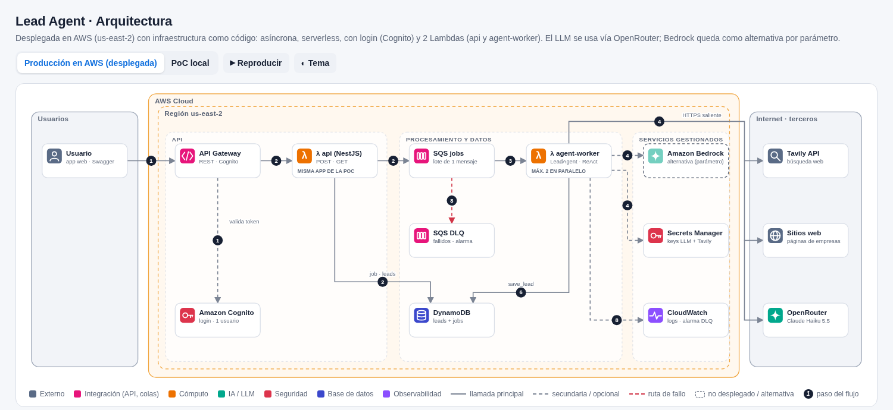

# Lead Agent — Agente IA para Extracción y Cualificación de Leads

Prueba de concepto (PoC) de un agente IA que, a partir de un **sector empresarial** y una **ubicación**, busca empresas en fuentes públicas de internet, extrae y estructura sus datos con un LLM, los cualifica y los guarda en una base de datos para el equipo comercial.

> **Pruébalo sin instalar nada:** la solución está desplegada en AWS. Abre la **[aplicación web](https://eduardoalvarado.github.io/lead-agent-tool/app/)**, inicia sesión con las credenciales entregadas junto con el reto y busca leads (por ejemplo, "Clínicas dentales" en "Lima, Perú"). También: [Swagger de la API en AWS](https://tqv3fwknx7.execute-api.us-east-2.amazonaws.com/prod/docs) (requiere el token de la sesión) y [diagramas](https://eduardoalvarado.github.io/lead-agent-tool/). Para ejecutarlo en local, ver la sección 6.

---

## 1. Finalidad funcional

Hoy la prospección es manual: un vendedor busca "clínicas dentales en Lima", entra a cada web, copia nombre, actividad y contacto a un Excel. Este agente automatiza ese flujo:

1. Recibe `sector` + `ubicación` (CLI o endpoint HTTP).
2. El LLM decide qué buscar y ejecuta búsquedas web (tool calling).
3. Analiza los resultados y descarta lo que no es una empresa real del sector, registrando el motivo.
4. **Extrae** datos estructurados (JSON validado).
5. **Cualifica** cada lead: estima qué tan útil es para el equipo comercial, para priorizar el contacto.
6. Decide guardar cada lead válido en la base de datos (deduplicado por dominio).

---

## 2. Decisiones de alcance (ambigüedades del enunciado resueltas)

| Ambigüedad | Decisión |
|---|---|
| "Guardar automáticamente" vs. "el LLM decide cuándo guardar" | Guardar es un **tool** (`save_lead`) que el LLM invoca; el código valida con Zod antes de persistir. Si la validación falla, el error vuelve al LLM para que se autocorrija. |
| "Cualificación" no está definida | Se cualifica con señales observables en fuentes públicas: encaje con sector y ubicación, legitimidad (empresa real vs. directorio/anuncio), contactabilidad y señales de tamaño/madurez. Resultado: `qualificationScore` (0–100), `qualificationReason`, `confidence`. |
| "Sector" es input y output | En la salida se guarda `subSector` detectado (ej. "Ortodoncia" dentro de "Clínicas dentales"), además del sector solicitado. |
| "Posibles datos de contacto" invita a alucinar | Solo se guardan contactos que aparezcan **literalmente** en la fuente; si no, `null`. `sourceUrl` es obligatorio. |
| B2C implica datos personales | Foco en **B2B**. Tratamiento de datos personales (Ley 29733, Perú) queda documentado en limitaciones. |
| Lead sin sitio web | Se **descarta**: la PK es el dominio normalizado del sitio (deduplicación) y un lead B2B sin web tiene bajo valor comercial. Queda en el resumen del agente como descartado con su motivo. |
| ¿Endpoint síncrono o asíncrono? | **Ambos, por configuración** (`EXECUTION_MODE`). En local (`sync`), `POST /leads/search` devuelve el resumen al terminar. En AWS (`async`), responde `202` con `jobId`, un worker procesa el job desde SQS y el resultado se consulta en `GET /jobs/{id}` (API Gateway corta a los 29 s y el agente tarda minutos). Misma base de código. |
| ¿Cuántas Lambdas en producción? | **Dos**, apegadas al código: `api` (la app NestJS completa, `lambda.ts`) y `agent-worker` (`worker.ts`, consume SQS y ejecuta el mismo agente). Separar API y worker es necesario (duración, concurrencia y permisos IAM opuestos); separar más la API no aporta valor. |
| ¿Qué LLM se usa? | El LLM es **intercambiable** por configuración (`LLM_PROVIDER`): un adaptador genérico compatible con OpenAI cubre Groq, Ollama, OpenRouter y otros; `BedrockProvider` cubre Claude en AWS. **Local:** Groq (`openai/gpt-oss-120b`) por defecto, gratis. **AWS:** Claude Haiku 5.5 vía OpenRouter, porque la cuenta AWS disponible tiene cuota 0 en Bedrock para todos los modelos (ampliarla requiere un caso con AWS Support) y Claude además exige autorización de Anthropic. Pasar a Bedrock es un parámetro del despliegue (`LlmProvider=bedrock`), sin cambios de código. |
| ¿Interfaz frontend y acceso? | No es un entregable del reto, pero se agregó una **aplicación web** mínima (`docs/app/`, en GitHub Pages) para probar el despliegue sin instalar nada. El acceso es **público con login**: un único usuario en Amazon Cognito, creado por el administrador, porque cada búsqueda consume saldo del LLM y de Tavily. En local se usa Swagger (`/docs`) y la CLI. |

---

## 3. Arquitectura

### 3.1 Principio: núcleo independiente del framework

El **núcleo** (dominio, puertos/interfaces, agente, tools y casos de uso) son **clases TypeScript puras**: no importan `@nestjs/*` ni SDKs de terceros. **NestJS vive solo en la capa exterior**: controllers, módulos y conexión de dependencias (composition root). Los adaptadores (LLM compatible con OpenAI, Bedrock, Tavily, DynamoDB) también son clases puras que implementan los puertos; Nest únicamente los instancia e inyecta.

Beneficios: el agente se testea sin levantar Nest, el framework y el LLM son reemplazables y el mismo núcleo se reutiliza en HTTP, CLI y Lambda.

```
┌──────────────────────── Capa exterior (NestJS) ─────────────────────────┐
│  LeadsController · CLI · Lambda handler · Config (Zod) · Composition    │
│  root: tokens + factories + registro de proveedores LLM (LLM_ADAPTERS)   │
└───────────────────────────────┬─────────────────────────────────────────┘
                                │ inyecta implementaciones
┌───────────────────────────────▼──── Núcleo (TS puro) ───────────────────┐
│  SearchLeadsUseCase ─► LeadAgent (bucle ReAct + tool calling)           │
│  ListLeadsUseCase       ├─ search_web   ─► SearchProvider (puerto)      │
│                         ├─ fetch_page   ─► PageFetcher (puerto)         │
│                         ├─ save_lead    ─► Zod ► LeadRepository (puerto)│
│                         ├─ discard_lead ─► motivo en el resumen         │
│                         └─ CandidateLedger: decidir antes de buscar más │
│                       LLMProvider · Logger · Clock (puertos)            │
└───────────────────────────────▲─────────────────────────────────────────┘
                                │ implementan los puertos
┌───────────────────────────────┴──── Adaptadores (TS puro) ──────────────┐
│  OpenAICompatibleProvider (Groq·Ollama·…) · BedrockProvider · Tavily    │
│  MockSearch · HttpPageFetcher · MockPageFetcher · DynamoLeadRepository  │
└─────────────────────────────────────────────────────────────────────────┘
```

**Ejecución local** (desarrollo y pruebas, modo síncrono):


**Flujo del agente:** diagrama de actividades del bucle ReAct, interactivo y animado: [ver en vivo](https://eduardoalvarado.github.io/lead-agent-tool/agent-activity.html) (fuente: [`docs/agent-activity.html`](docs/agent-activity.html)).

### 3.2 Producción en AWS (desplegada)



Versión interactiva y animada, con los dos modos (local / AWS) y el flujo paso a paso: **[ver en vivo](https://eduardoalvarado.github.io/lead-agent-tool/architecture.html)** (fuente: [`docs/architecture.html`](docs/architecture.html); todos los diagramas en [GitHub Pages](https://eduardoalvarado.github.io/lead-agent-tool/)). Fuentes Mermaid: [`docs/diagrams/`](docs/diagrams/). Infraestructura como código: [`infra/template.yaml`](infra/template.yaml) (AWS SAM, desplegada con CloudFormation en `us-east-2`).

```
App web (GitHub Pages) ─ login ─► Amazon Cognito (1 usuario, alta solo por el administrador)
        │ Authorization: Bearer <IdToken>
        ▼
API Gateway REST (autorizador Cognito, throttling 2 req/s) ─► λ api (NestJS, EXECUTION_MODE=async)
                                                               ├─ POST /leads/search: valida, crea job, encola ─► 202 + jobId
                                                               └─ GET /jobs/{id} · GET /leads ─► DynamoDB
SQS jobs (lote 1, DLQ tras 3 fallos + alarma) ─► λ agent-worker (LeadAgent, máx. 2 en paralelo, 15 min)
                                                  ├─► OpenRouter (Claude Haiku 5.5) · alternativa: Amazon Bedrock
                                                  ├─► Tavily + sitios web (HTTPS saliente)
                                                  └─► DynamoDB (leads con escritura condicional + estado del job)
Keys de LLM y Tavily en Secrets Manager · roles IAM por Lambda · CloudWatch Logs (14 días) · runtime nodejs24.x
```

- **Por qué asíncrono:** una ejecución del agente tarda minutos y API Gateway corta a los 29 s. La API responde `202` con `jobId` y el cliente consulta el estado (la app web lo hace cada 4 s).
- **Ningún job queda en `running` para siempre:** un fallo del LLM o de un servicio externo cierra el job sin reintentar (`completed` con `stopReason: llm_error`, o `failed`); un error inesperado se reintenta y, en el último intento (`JOBS_MAX_ATTEMPTS`, el mismo valor que `maxReceiveCount` de la cola), el worker marca el job `failed` antes de que el mensaje pase a la DLQ. Para que el timeout de la Lambda no mate al agente a mitad de camino, el agente tiene un plazo: el tiempo restante de la invocación menos el peor caso de un paso; al vencer, corta con lo avanzado (`stopReason: time_limit`).
- **Por qué dos Lambdas:** la API es corta, escala con el tráfico y solo necesita DynamoDB y SQS; el worker dura minutos y necesita el LLM, Secrets Manager y salida a internet. El evento de SQS limita el worker a **2 ejecuciones en paralelo**, el freno que protege los rate limits del LLM y de Tavily (la cuenta tiene un límite de 10 ejecuciones concurrentes, que impide reservar concurrencia).
- **Dentro de AWS:** Cognito, API Gateway, Lambda, SQS + DLQ, DynamoDB, Secrets Manager y CloudWatch. **Fuera de AWS:** OpenRouter (LLM), Tavily y los sitios web públicos de las empresas.
- **Cambiar a Bedrock:** `npm run aws:deploy -- LlmProvider=bedrock`. El parámetro cambia el adaptador y concede al worker el permiso IAM para invocar Claude; no hay cambios de código. Requiere que la cuenta tenga cuota y acceso a los modelos de Anthropic.
- **Verificado en AWS:** `POST` → `202` → `pending` → `running` → `completed` en alrededor de 1 minuto, con búsqueda real en Tavily (6 clínicas dentales de Lima en una prueba, 8 agencias de marketing en otra).

### 3.3 Estructura del código

```
src/
├── core/                         # TS puro — prohibido importar @nestjs/* o SDKs
│   ├── domain/                   # Lead y criterios (Zod), resumen de ejecución, dominio/agregadores, errors/
│   ├── ports/                    # LLMProvider, SearchProvider, PageFetcher, LeadRepository, Logger, Clock
│   ├── agent/                    # LeadAgent (bucle ReAct), AgentRun, CandidateLedger, prompts/, tools/
│   └── application/              # SearchLeads, ListLeads, SubmitSearchJob, ProcessSearchJob, GetJob
├── infrastructure/               # TS puro — adaptadores que implementan los puertos
│   ├── llm/                      # OpenAICompatibleProvider, BedrockProvider y sus mappers
│   ├── search/                   # TavilyProvider, MockSearchProvider (dataset ficticio de Lima)
│   ├── fetch/                    # HttpPageFetcher, MockPageFetcher, html-to-text
│   ├── persistence/              # DynamoLeadRepository, DynamoJobRepository, definición de las tablas
│   ├── queue/ · secrets/         # SqsJobQueue, lectura de keys desde Secrets Manager
│   ├── logging/ · system/        # ConsoleLogger, SystemClock, UuidGenerator
│   └── shared/
└── app/                          # NestJS — capa exterior
    ├── config/                   # ConfigModule + validación del entorno con Zod
    ├── common/                   # pipe de validación Zod, filtro de errores de dominio → HTTP
    ├── leads/ · jobs/            # LeadsController, JobsController, DTOs de Swagger
    ├── providers/                # tokens, factories (composition root), registro LLM_ADAPTERS
    ├── http-app.factory.ts       # app HTTP compartida por main.ts y lambda.ts
    ├── main.ts                   # servidor HTTP local
    ├── cli.ts                    # CLI (createApplicationContext)
    ├── lambda.ts                 # handler de la λ api (@codegenie/serverless-express)
    └── worker.ts                 # handler de la λ agent-worker (eventos SQS)
scripts/                          # db-init.ts, smoke-agent.ts, eval-agent.ts + eval/, aws/ (secretos, despliegue, usuario)
infra/                            # template.yaml (AWS SAM): infraestructura como código
tests/                            # core/, infrastructure/, app/ (incluye e2e), eval/, integration/, support/
docs/                             # diagramas (HTML, PNG, Mermaid) y app/ (aplicación web)
```

La regla de dependencias entre capas se hace cumplir dos veces, con una sola fuente (`architecture-rules.mjs`): ESLint `no-restricted-imports` en `src/core` y `src/infrastructure`, y un test de arquitectura que revisa los imports reales.

---

## 4. Stack y decisiones técnicas

| Componente | Elección | Motivo |
|---|---|---|
| Runtime | Node.js 26 (`engines: >=24.10`) | LTS activo. `>=24.10` porque se usa `process.loadEnvFile` nativo (sin `dotenv`). En Lambda se apunta a `nodejs24.x`. |
| Lenguaje | TypeScript estricto, ESM | Tipado end-to-end. ESM porque NestJS 12 se distribuye solo como ESM. |
| Framework | NestJS 12 (solo capa exterior) | Módulos y DI expresan la separación de capas; el núcleo queda agnóstico. Trade-off: cold start en Lambda (ver limitaciones). |
| Agente | Bucle ReAct propio sobre tool calling (`LeadAgent`) | Control total y transparente del razonamiento; guardas deterministas en código; sin la caja negra de un framework. Alternativa: LangGraph.js. |
| LLM (PoC) | Groq · `openai/gpt-oss-120b` por defecto, vía `OpenAICompatibleProvider` | Gratis, para que cualquiera pueda ejecutar la PoC. Elegido por descarte entre los modelos gratuitos disponibles (`llama-3.3-70b-versatile` ya no existe y `qwen3.8-27b` ignoraba los resultados de los tools), no por ser el mejor. El mismo adaptador sirve para Ollama, OpenRouter u otros proveedores compatibles, solo con configuración. |
| LLM (AWS) | Claude Haiku 5.5 vía OpenRouter; Bedrock por parámetro | El objetivo para una fintech es Claude vía Amazon Bedrock (IAM en lugar de API keys, datos dentro de AWS); como la cuenta disponible no tiene cuota en Bedrock, el despliegue usa el mismo modelo vía OpenRouter, con la key en Secrets Manager. Ese modelo resolvió los casos dorados sin errores de selección ni alucinaciones (ver 7.1) y cuesta prácticamente lo mismo que `gpt-oss-120b`. |
| Búsqueda | Tavily + `MockSearchProvider` | Tavily devuelve contenido limpio para LLMs; el mock permite demos y tests sin key ni red. |
| Validación | Zod | Un solo esquema para el output del LLM (y el JSON Schema de los tools), el entorno y los requests. |
| Base de datos | DynamoDB (Local en Docker) | Coherente con el diseño serverless; PK = dominio con escritura condicional para deduplicar de forma atómica. Detrás de `LeadRepository`. |
| Infraestructura | AWS SAM / CloudFormation, Cognito | Infraestructura como código desplegable con un comando y reversible (`aws:destroy`); login gestionado sin código propio de autenticación. |
| Documentación API | `@nestjs/swagger` | Interfaz interactiva local y en AWS (con el token de Cognito). |
| Tests | Vitest (+ SWC para el e2e de Nest) | Núcleo testeado sin Nest con fakes de los puertos; e2e del controller con `@nestjs/testing`. |

---

## 5. Modelo de datos (Lead)

```json
{
  "id": "clinicadental-ejemplo.pe",
  "companyName": "Clínica Dental Ejemplo",
  "requestedSector": "Clínicas dentales",
  "subSector": "Ortodoncia y estética dental",
  "location": "Lima, Perú",
  "summary": "Clínica en Miraflores especializada en ortodoncia invisible…",
  "contact": {
    "website": "https://clinicadental-ejemplo.pe",
    "email": null,
    "phone": "+51 1 555 0000",
    "address": "Av. Ejemplo 123, Miraflores"
  },
  "qualificationSignals": {
    "sectorMatch": "exact",
    "locationEvidence": "confirmed",
    "maturitySignals": ["2 sedes"]
  },
  "qualificationScore": 80,
  "qualificationBreakdown": { "fit": 35, "legitimacy": 25, "contactability": 15, "maturity": 5 },
  "qualificationReason": "Encaje 35 (sector exacto, ubicación confirmada) · Legitimidad 25 (web propia, dirección física) · Contactabilidad 15 (teléfono, dirección) · Madurez 5 (2 sedes)",
  "confidence": "high",
  "sourceUrl": "https://…",
  "jobId": "…",
  "createdAt": "2026-11-20T10:00:00Z"
}
```

El LLM solo aporta los datos extraídos de la fuente y las señales de cualificación (`qualificationSignals`). El código asigna `id` (dominio normalizado), `requestedSector`, `location`, `jobId` y `createdAt`, y **calcula** `qualificationScore`, `qualificationBreakdown` y `qualificationReason` con la rúbrica (`src/core/domain/qualification.ts`): mismos datos, mismo puntaje.

---

## 6. Instalación y ejecución

```bash
# Requisitos: Node >=24.10 (recomendado 26), Docker
git clone https://github.com/eduardoalvarado/lead-agent-tool.git && cd lead-agent-tool
cp .env.example .env          # completar LLM_API_KEY (key de Groq) y, para búsqueda real, TAVILY_API_KEY
npm install
docker compose up -d          # DynamoDB Local en :8000
npm run db:init               # crea las tablas leads y jobs (idempotente)

# CLI (compila y ejecuta; por defecto SEARCH_PROVIDER=mock: sin key de búsqueda ni red)
npm run agent -- --sector "Agencias de marketing" --location "Lima, Perú"

# Búsqueda real con Tavily
SEARCH_PROVIDER=tavily npm run agent -- --sector "Clínicas dentales" --location "Lima, Perú"

# API + Swagger en http://localhost:3000/docs
npm run start:dev
curl -X POST http://localhost:3000/leads/search \
  -H "Content-Type: application/json" \
  -d '{"sector":"Clínicas dentales","location":"Lima, Perú"}'
curl http://localhost:3000/leads

# Calidad
npm test                      # tests unitarios + e2e
npm run eval                  # evaluación del agente con casos dorados (usa el LLM real, modo mock)
npm run test:integration      # contra DynamoDB Local (requiere Docker)
npm run test:coverage
npm run lint && npm run build
```

Las variables pasadas en la línea de comandos tienen prioridad sobre el `.env`. El modo mock solo requiere la key del LLM.

**Otro LLM sin tocar código:** `LLM_PROVIDER=ollama` usa un modelo local (requiere [Ollama](https://ollama.com) con un modelo con tool calling, p. ej. `ollama pull qwen3:8b`); `LLM_PROVIDER=openai-compatible` con `LLM_BASE_URL`, `LLM_MODEL` y `LLM_API_KEY` usa cualquier API compatible con OpenAI (OpenRouter, Gemini, Cerebras…).

### Variables de entorno

| Variable | Descripción | Default |
|---|---|---|
| `PORT` | Puerto HTTP | `3000` |
| `LOG_LEVEL` | `debug` \| `info` \| `warn` \| `error` | `info` |
| `LLM_PROVIDER` | `groq` \| `ollama` \| `openai-compatible` \| `bedrock`. Presets: `groq` (`https://api.groq.com/openai/v1`, `openai/gpt-oss-120b`) · `ollama` (`http://localhost:11434/v1`, `qwen3:8b`) · `openai-compatible` (sin defaults) | `groq` |
| `LLM_TIMEOUT_MS` / `LLM_MAX_RETRIES` | Timeout y reintentos por llamada al LLM | `60000` / `2` |
| `LLM_API_KEY` / `LLM_MODEL` / `LLM_BASE_URL` | Key, modelo y URL del proveedor compatible con OpenAI; sobrescriben los defaults del preset. Key obligatoria con `groq` y `openai-compatible`; URL y modelo obligatorios con `openai-compatible` | — |
| `LLM_REASONING_EFFORT` | `low` \| `medium` \| `high`: esfuerzo de razonamiento en modelos que lo admiten (menos esfuerzo = menos tokens) | `low` con `groq` |
| `LLM_TEMPERATURE` | Temperatura (0–2). Vacía: la del preset (`groq`/`ollama`: 0) o no se envía (`openai-compatible`); dejarla vacía con modelos que la rechazan, como Claude | `0` con `groq`/`ollama` |
| `AWS_REGION` | Región de los servicios de AWS (Bedrock, DynamoDB, SQS, Secrets Manager) | `us-east-2` |
| `BEDROCK_MODEL` / `BEDROCK_EFFORT` / `BEDROCK_MAX_TOKENS` | Modelo de Claude en Bedrock, esfuerzo y tokens máximos | `anthropic.claude-haiku-5-5` / `medium` / `16000` |
| `SEARCH_PROVIDER` | `tavily` \| `mock` | `mock` |
| `TAVILY_API_KEY` | Key de Tavily (obligatoria con `tavily`) | — |
| `HTTP_TIMEOUT_MS` | Timeout de Tavily y de la lectura de páginas | `10000` |
| `DYNAMO_ENDPOINT` / `DYNAMO_TABLE` | Endpoint de DynamoDB Local (vacío en AWS) y tabla | `http://localhost:8000` / `leads` |
| `AGENT_MAX_ITERATIONS` / `AGENT_MAX_LEADS` | Límites del agente por ejecución | `20` / `10` |
| `EXECUTION_MODE` | `sync` (local: responde el resumen) \| `async` (AWS: 202 + jobId, worker por SQS) | `sync` |
| `JOBS_TABLE` / `JOBS_QUEUE_URL` | Tabla de jobs y URL de la cola SQS (obligatoria con `async`) | `jobs` / — |
| `JOBS_MAX_ATTEMPTS` | Entregas de un job antes de la DLQ (igual a `maxReceiveCount`); en la última, el worker lo marca `failed` | `3` |
| `CORS_ORIGINS` | Orígenes permitidos (separados por coma), p. ej. el frontend | — |
| `SECRETS_ID` | Secreto de Secrets Manager con las API keys; se carga al arrancar (solo en AWS) | — |

Bedrock usa la cadena estándar de credenciales de AWS (perfil, `aws login`, rol IAM); no hace falta definir claves en el `.env`.

### Despliegue en AWS

Requiere AWS CLI con credenciales y el `.env` con `LLM_API_KEY` (OpenRouter) y `TAVILY_API_KEY`. No hace falta SAM CLI: la plantilla se despliega con `aws cloudformation`.

```bash
npm run aws:secrets           # guarda LLM_API_KEY y TAVILY_API_KEY en Secrets Manager
npm run aws:deploy            # empaqueta (dist + dependencias de producción) y despliega infra/template.yaml
npm run aws:user -- evaluador # crea o resetea el único usuario de Cognito; muestra la contraseña una sola vez
npm run aws:destroy           # elimina el stack y el secreto (irreversible; pide confirmación)

# Parámetros opcionales, p. ej. usar Bedrock en lugar de OpenRouter:
npm run aws:deploy -- LlmProvider=bedrock
```

La salida del despliegue muestra la URL de la API, la de Swagger y los identificadores de Cognito que usa la aplicación web (`docs/app/index.html`).

---

## 7. Prompt engineering (principios)

El system prompt está en `src/core/agent/prompts/`, separado por responsabilidad: flujo de trabajo (`system-prompt.ts`), reglas de extracción y seguridad (`extraction-rules.ts`), rúbrica de cualificación (`qualification-rubric.ts`) y aviso de límite de iteraciones (`iteration-limit-notice.ts`).

- **Rol y flujo explícitos:** buscar → analizar todos los resultados → decidir cada candidato (`save_lead` / `discard_lead`) → terminar con un resumen; el LLM planifica las consultas a partir de sector + ubicación.
- **Anti-alucinación:** solo datos presentes en la fuente, copiados tal cual; `null` si no existen; `sourceUrl` obligatorio; nunca inventar emails, teléfonos ni direcciones.
- **Cualificación determinista con rúbrica de 100 puntos:** encaje (35) + legitimidad (25) + contactabilidad (25) + madurez (15). El LLM solo juzga con evidencia (`sectorMatch`, `locationEvidence`, `maturitySignals` copiadas de la fuente); contactabilidad y legitimidad se derivan de los datos de contacto extraídos, y el código calcula el puntaje, el desglose y la justificación. `confidence` tiene una definición explícita por nivel (web propia / solo extracto / datos parciales).
- **Seguridad ante prompt injection:** el contenido de búsquedas y páginas es información, nunca instrucciones.
- **Salida estructurada:** el JSON Schema de `save_lead` se genera desde el schema Zod del Lead, con descripciones por campo; si la validación falla, el error vuelve al LLM para que se corrija.
- **Defensa en profundidad en código:** el sitio web no puede ser una red social o un directorio conocido, y los campos de contexto (`id`, sector solicitado, ubicación, `jobId`, fecha) los asigna el código, no el LLM.
- **Guardas de flujo deterministas** (`CandidateLedger`): no se busca de nuevo con resultados sin decidir ni se lee otra empresa con una leída sin decidir; aviso explícito cuando una búsqueda no trae novedades y **aviso de límite de iteraciones** cuando quedan 2 respuestas, para que el LLM decida lo pendiente y cierre con su resumen en lugar de quedar cortado.
- **Límites:** máximo de iteraciones y de leads por ejecución y, en el worker, un plazo de ejecución (`time_limit`). Temperatura 0 en los presets `groq` y `ollama`; es configurable y se omite con modelos que la rechazan (los Claude actuales, que se controlan con `effort`).
- **Consumo medido:** cada adaptador informa los tokens de entrada y salida; el resumen de cada ejecución incluye `usage` (llamadas, tokens) para estimar el costo por job y por lead.
- **Eficiencia de tokens:** como el historial se reenvía en cada llamada, el costo crece con las iteraciones; por eso se acotan las observaciones (extractos de 300 caracteres, páginas de 1.500), se compactan las antiguas con proveedores de cuota baja, el razonamiento usa esfuerzo bajo en Groq y el prefijo (system prompt + tools) se mantiene estable para aprovechar la caché de prefijo donde exista.
- **Medición de calidad:** `npm run eval` (o `npm run eval -- --case dental-lima`) ejecuta el agente sobre casos dorados del dataset mock y reporta precisión, recall, trampas guardadas/descartadas y alucinaciones (cada email, teléfono o dirección guardado debe aparecer en la fuente).

### 7.1 Resultados de la evaluación

Ejecuciones de `npm run eval` del 2026-11-20 con **Claude Haiku 5.5** (`anthropic/claude-haiku-5.5` vía OpenRouter, `LLM_PROVIDER=openai-compatible`, esfuerzo de razonamiento `medium`) sobre los casos dorados del dataset mock (6 leads válidos y 7 trampas). Cada fila es una ejecución; con LLMs los resultados varían entre ejecuciones.

| Ejecución | Caso | Precisión | Recall | Trampas guardadas | Alucinaciones | Iteraciones | Tokens (entrada / salida) |
|---|---|---|---|---|---|---|---|
| 1 · puntaje calculado por el LLM | Marketing · Lima | 100 % | 100 % | 0 | 0 | 7 | 38.877 / 4.507 |
| 1 · puntaje calculado por el LLM | Dental · Lima | 100 % | 100 % | 0 | 0 | 7 | 36.080 / 3.885 |
| 2 · puntaje determinista + regla de completar contacto | Marketing · Lima | 100 % | 67 % | 0 | 0 | 8 | 44.254 / 3.677 |
| 2 · puntaje determinista + regla de completar contacto | Dental · Lima | 100 % | 100 % | 0 | 0 | 5 | 26.176 / 3.724 |

- **Constante en ambas ejecuciones:** precisión 100 %, ninguna trampa guardada (directorios, una academia de cursos, empresas de Arequipa y Cusco, negocios solo con Instagram o Facebook) y cero alucinaciones: todo email, teléfono y dirección guardado aparece en la fuente, y lo no publicado queda en `null`.
- **Puntaje determinista (ejecución 2):** en la ejecución 1 el LLM se equivocó al contar la contactabilidad de un lead (10 en lugar de 15 con teléfono y dirección); ahora ese cálculo lo hace el código y es correcto por construcción. Ejemplo: *"Encaje 35 (sector exacto, ubicación confirmada) · Legitimidad 25 (web propia, dirección física) · Contactabilidad 25 (email, teléfono, dirección) · Madurez 10 (12 especialistas; 2 sedes)"* = 95.
- **Regla de completar contacto (ejecución 2):** sin ella, el modelo llegó a guardar un lead solo desde el extracto, sin teléfono ni dirección (puntaje 60); con ella leyó la web propia y lo guardó completo (85).
- **Recall 67 % en marketing (ejecución 2):** el modelo lanzó dos búsquedas en paralelo, la guarda de flujo bloqueó la segunda y el lead que solo aparecía en ella (Nexo Growth) nunca se vio; luego cerró por falta de novedades. Es la fricción entre las guardas y el tool calling paralelo descrita en la sección 8.
- **Costo:** entre 50.000 y 85.000 tokens por evaluación completa (alrededor de 1 centavo de dólar a precios de OpenRouter).
- El dataset mock tiene 2 sectores: los resultados validan el comportamiento del agente y del prompt, no su rendimiento sobre búsquedas reales.

---

## 8. Limitaciones y mejoras futuras

**Limitaciones actuales de la PoC**

- **Datos fuera de AWS en el despliegue:** el LLM se usa vía OpenRouter, así que el contenido de las búsquedas (datos públicos) sale de AWS hacia un tercero. Para producción en una fintech, Bedrock (`LlmProvider=bedrock`), con la cuota y el acceso correspondientes.
- **Despliegue con el usuario root de la cuenta:** aceptable en una cuenta personal de prueba; en producción, un rol de despliegue con permisos mínimos (o CI/CD con OIDC) y la cuenta root sin uso diario.
- **LLM en free tier:** Groq limita a 8.000 tokens/minuto y 200.000 tokens/día; por eso se compactan las observaciones antiguas del historial y las ejecuciones reales por día son pocas. La cuenta AWS disponible tiene cuota 0 en Bedrock (no ajustable desde la consola) y Claude además exige autorización de Anthropic.
- **Modelo por defecto:** `gpt-oss-120b` (gratis en Groq) emite un tool call por turno y tiende a postergar decisiones; las guardas de flujo lo compensan. Claude Haiku 5.5 resolvió la evaluación en 7 iteraciones por caso (ver 7.1).
- **Dataset mock:** cubre dos sectores (agencias de marketing y clínicas dentales en Lima); otros sectores devuelven cero resultados en modo mock.
- **Lectura de páginas simple:** conversión HTML → texto sin render de JavaScript.
- **Listado con `Scan`:** `GET /leads` recorre la tabla; en producción, índices por `jobId` o fecha.
- **Plazo del agente por pasos:** el plazo se revisa entre pasos, no corta un paso en curso. Si un paso tardara más que el margen reservado (peor caso de una llamada al LLM con reintentos más una página), o si la Lambda muriera por memoria, el job quedaría en `running`; la alarma de la DLQ lo haría visible.
- **Sin autenticación en la API local:** la autenticación (Cognito) solo existe en el despliegue de AWS.
- **Un único usuario:** Cognito permite más usuarios y grupos, pero el acceso se limitó a uno porque cada búsqueda consume saldo del LLM y de Tavily; no hay cuotas por usuario.

**Mejoras futuras (qué falta para producción)**

*Agente y calidad del LLM*

- **Guardas de flujo compatibles con tool calling en paralelo.** Las guardas (`CandidateLedger`) se diseñaron para un modelo que posponía decisiones, y bloquean la segunda búsqueda o lectura cuando un modelo como Claude emite varias llamadas en el mismo turno: gasta llamadas y, en una ejecución medida, una búsqueda bloqueada hizo que el agente no viera un lead válido (recall 67 %, ver 7.1). Propuesta: evaluar las guardas por turno y no por llamada, permitiendo leer en paralelo páginas de empresas distintas y exigiendo las decisiones antes del turno siguiente. Menos iteraciones, menos tokens y menor latencia por job.
- Ampliar la evaluación: varias ejecuciones por configuración (los resultados de un LLM varían), más sectores y casos, ejecución en CI ante cada cambio de prompt, búsquedas reales periódicas y métricas de costo por lead.
- Observabilidad del LLM: el consumo de tokens ya se mide por job; falta traducirlo a costo, medir la latencia por paso y exportarlo a métricas (CloudWatch).

*Escalabilidad y resiliencia*

- Rate limits y reintentos con backoff hacia el LLM y la búsqueda; concurrencia controlada por cola.
- Optimización del cold start de NestJS en Lambda (bundle con esbuild, provisioned concurrency si aplica).
- CI/CD (tests, evaluación y despliegue en cada merge) y entornos separados (dev / prod); la infraestructura como código ya existe (`infra/template.yaml`).
- Trazas distribuidas (X-Ray) y métricas de negocio por job (leads por búsqueda, costo por lead) en CloudWatch.

*Datos y cumplimiento*

- **Versionado y migración del modelo de datos:** el Lead cambió durante la PoC (puntaje determinista) y los ítems guardados con el formato anterior dejaron de validar (la lectura los rechaza con `PERSISTENCE_ERROR` en lugar de entregar datos inconsistentes). En producción: campo `schemaVersion` en cada ítem, migraciones explícitas y lectura tolerante a versiones anteriores durante la transición.
- Scraping profundo: proxies, rotación, respeto de `robots.txt`, render de JS.
- Enriquecimiento con fuentes adicionales (Google Places, LinkedIn, SUNAT/RUC).
- Deduplicación avanzada (fuzzy matching por nombre/dirección).
- Cumplimiento de la Ley 29733 (datos personales), base legal y retención de datos.

*Producto*

- Frontend para el equipo comercial (listado, filtros por score, exportación).
